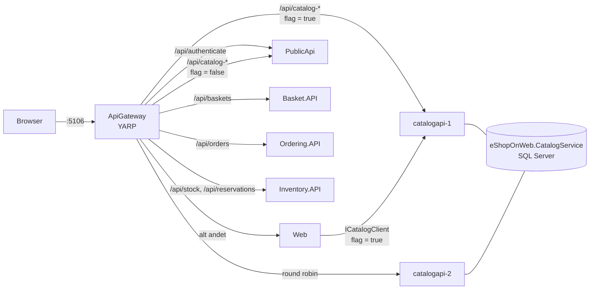

# API Gateway og kataloget (Strangler Fig)

Gatewayen (`src/ApiGateway`, YARP) er facaden foran monolitten og de nye services. Den tager imod på port 5106,
som Web brugte før, så brugerne ikke mærker, at den er kommet ind. Kataloget er flyttet ud i Catalog.API
(`src/Services/Catalog.API`), og ét feature flag, `UseCatalogService`, bestemmer, om monolitten eller Catalog.API ejer det.



## Routes

| Route | Går til | Adgang | Rate limit |
| --- | --- | --- | --- |
| `GET /api/catalog-items/**`, `/api/catalog-brands`, `/api/catalog-types` | Catalog.API (to instanser) eller PublicApi | Alle | `api` |
| `POST/PUT/DELETE /api/catalog-items/**` | Catalog.API eller PublicApi | Rollen Administrators | `api` |
| `/api/authenticate` | PublicApi | Alle | `login` |
| `/api/baskets/**` | Basket.API (`/api` fjernes) | JWT | `api` |
| `/api/orders/**` | Ordering.API (`/api` fjernes) | JWT | `api` |
| `/api/stock/**`, `/api/reservations/**` | Inventory.API (`/api` fjernes) | JWT | `api` |
| Alt andet | Web (Host-headeren bevares) | Som i dag | `web` |

Routes og clusters står i `src/ApiGateway/appsettings.json`. Rate limits er et fast vindue pr. IP-adresse:
`web` 1000, `api` 100 og `login` 10 kald i minuttet (kan ændres under `RateLimits`). Over grænsen svarer gatewayen 429.

## Feature flaget

`USE_CATALOG_SERVICE` i `.env` sendes til både Web og gatewayen som `UseCatalogService`:

| | `false` (monolitten ejer kataloget) | `true` (Catalog.API ejer kataloget) |
| --- | --- | --- |
| Web: forside, kurv, ordre, gammel admin-side | `LocalCatalogClient` → monolittens database | `CatalogApiClient` → `http://catalogapi:8080` |
| Gatewayen: `/api/catalog-*` (BlazorAdmin) | PublicApi | Catalog.API, fordelt på to instanser |

Fordi begge læser samme flag, skifter læsning og skrivning i samme trin. Der er aldrig to steder, der tager imod ændringer.
Skift eller rul tilbage: ret `.env` og kør `docker compose up -d`.

## Kopien af kataloget

Første gang `catalogapi-1` starter (`Catalog__InitializeDatabase=true`), kører den migrations og kopierer mærker,
typer og varer fra monolittens `Microsoft.eShopOnWeb.CatalogDb` til `eShopOnWeb.CatalogService` i én transaktion.
Id'erne bevares (`IDENTITY_INSERT`), fordi kurve, ordrer og lageret allerede bruger dem. Er Catalog.API's database
ikke tom, kopieres intet. `catalogapi-2` venter: dens `/health` svarer 503, til tabellerne findes, og gatewayen
sender ingen kald til den imens.

Kopien tages, mens flaget stadig er `false`. Ændres kataloget i monolitten bagefter, kommer ændringen ikke med.
Før skiftet skal man derfor lade være med at rette i kataloget, eller tage en frisk kopi (se nedenfor).

## Prøv det

```powershell
# Hvem svarer? Headeren skifter mellem catalogapi-1 og catalogapi-2, når flaget er true.
1..4 | % { (Invoke-WebRequest http://localhost:5106/api/catalog-brands -UseBasicParsing).Headers["X-Catalog-Instance"] }

# Load balancing og health checks: stop den ene instans. Efter ca. 10 sekunder svarer kun den anden
# (kald, der når den stoppede instans inden da, får 502 Bad Gateway).
docker compose stop catalogapi-2

# Autentificering i gatewayen: uden token afvises kaldet med 401, før det når Ordering.API.
Invoke-WebRequest "http://localhost:5106/api/orders?buyerId=demouser@microsoft.com" -UseBasicParsing
```

Swagger for Catalog.API: http://localhost:5600/swagger (kun catalogapi-1, kun fra denne maskine).

## Beslutninger

- **YARP frem for nginx/Traefik**: et almindeligt ASP.NET Core-projekt, så JWT og rate limiting bruger de samme
  biblioteker som resten af løsningen.
- **Flaget skifter ruten i et config-filter** (`CatalogStranglerFilter`). Ruterne står i appsettings.json, som om
  kataloget allerede er flyttet; filteret peger dem tilbage på PublicApi, så længe flaget er `false`.
- **Catalog.API i SQL Server**: to instanser skal dele databasen. De andre services bruger SQLite-filer.
- **Web kalder Catalog.API direkte** (Docker-navnet `catalogapi`, som begge instanser svarer på), ikke gennem
  gatewayen. Ellers ville alle butikkens egne kald tælle med i gatewayens rate limit for én IP-adresse.
- **Samme JSON som PublicApi**, så BlazorAdmin virker uændret. Catalog.API har to tilføjelser: `totalItems` i svaret
  og filteret `?ids=1&ids=5`, som Web bruger til kurven og ordren.

## Kendte begrænsninger

- Gatewayen kører i én instans og er et nyt sted, alt kan fejle.
- Gatewayen kræver JWT på `/api/orders/**`, men Ordering.API tjekker ikke selv, at `buyerId` er brugerens egen.
- Ved checkout hentes navn og billede fra Catalog.API, mens monolittens transaktion for ordren og outboxen er åben.
- En frisk kopi kræver, at Catalog.API's database er tom. SQL Server-containeren har intet volume, så
  `docker compose down` sletter begge databaser, og alt seedes og kopieres forfra.
- Den gamle katalogkode (`LocalCatalogClient`, PublicApi's katalog-endpoints og tabellerne i monolitten) slettes,
  når Catalog.API har kørt stabilt (issue #28).
